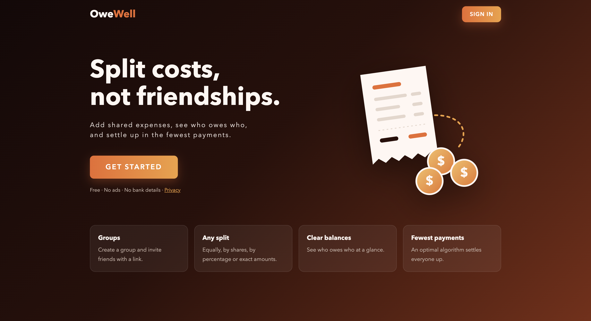
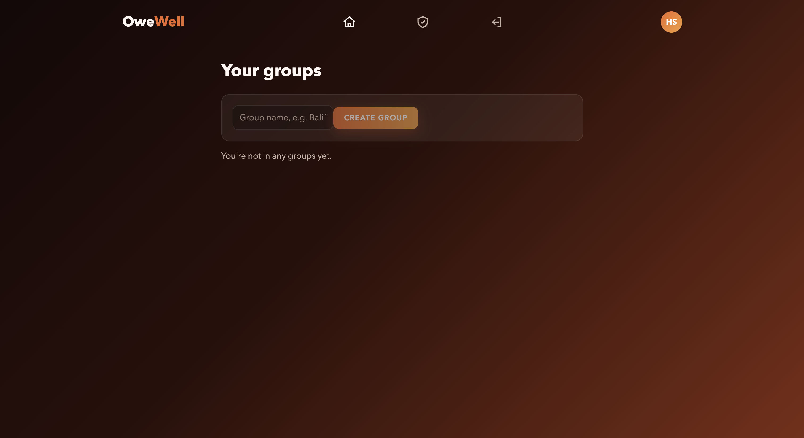
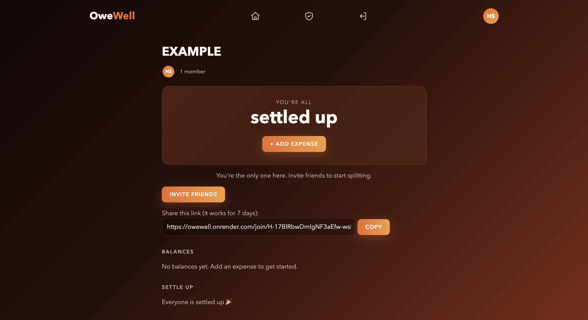

# OweWell


Split group expenses and settle up in the **fewest payments possible**.

**Live at [owewell.onrender.com](https://owewell.onrender.com)**. It runs on a free plan, so the first visit after a quiet spell can take up to a minute to wake up.

| Sign in | Your groups | A group |
|---|---|---|
|  |  |  |

## Status
✅ Live. The full app works end to end: Google sign-in, groups, invite links, expenses with four split types, balances and settling up, deployed with Docker on Render and Neon Postgres.

## Features
- **Google sign-in** with Spring Security (OAuth2 / OpenID Connect); users are saved to Postgres when they sign in
- **Groups and invite links:** create a group, share a link, and friends join after signing in. Links expire after 7 days, and only a SHA-256 hash of each token is stored, so a database leak doesn't expose working links
- **Four split types** behind a `SplitStrategy` interface, all guaranteed to add up exactly to the total:
  - `EqualSplit`: everyone pays the same ($10 ÷ 3 = $3.34 + $3.33 + $3.33)
  - `SharesSplit`: split by shares ("2 drinks vs 1")
  - `PercentageSplit`: split by percentages that must total 100%
  - `ExactSplit`: each person's exact amount
- **Money handling** in integer cents, so no rounding errors and no lost cents when splitting
- **Balances** showing who is owed and who owes across many expenses
- **Settle up** in the fewest payments, with a "Mark as paid" button for each payment
- **Event-sourced ledger:** expenses, deletions and payments are stored as events and never erased; balances are calculated by replaying the history, so every change has an audit trail
- **Soft-deleted groups:** any member can delete a group once everyone is settled up, so no debt can disappear; the group is hidden everywhere but its history is kept
- **Settlement algorithms** behind a `SettlementAlgorithm` interface:
  - `GreedySettlement`: fast; the biggest debtor pays the biggest creditor
  - `OptimalSettlement`: finds the true minimum number of payments using bitmask dynamic programming, O(n·2ⁿ)
  - `AutoSettlement`: uses optimal for up to 20 people and falls back to greedy for larger groups
- **REST API** for groups, invites, expenses, balances, settlement and payments, with clear 400 / 401 / 403 / 404 / 409 / 410 errors
- **PostgreSQL persistence:** ledger events are stored as JSONB in an append-only table and replayed to rebuild each group; the schema is managed with Flyway migrations
- **Optimistic locking:** each group remembers the version it was loaded at, and a primary key on `(group_id, sequence)` rejects stale saves, so two simultaneous edits can't silently lose data (returned as 409 Conflict)
- **Members-only access:** only members can view or change a group (403 Forbidden otherwise)
- **Security:** session cookies with CSRF protection (double-submit cookie pattern), and actions that change data are never triggered just by opening a page
- **Sessions stored in Postgres** with Spring Session JDBC, so redeploys and restarts don't sign anyone out; sign-ins last 14 days
- **React frontend** that works on phones and laptops: a balance summary card, an add-expense pop-up, an icon nav, a public landing page and a privacy policy

## Architecture
Clean (hexagonal) architecture in a single Spring Boot application:
- `domain`: pure Java business rules, with no framework code
- `application`: use cases (`GroupService`, `InviteService`), repository interfaces and access rules
- `infrastructure`: Postgres repositories for the app, plus in-memory repositories for fast tests
- `api`: REST controllers, request/response DTOs, error handling and the signed-in user (`CurrentUser`)

Swapping in-memory storage for PostgreSQL required no changes to the domain, service or API layers. The controller gets the signed-in user through a `CurrentUser` interface, so tests can use a fake user instead of real Google sign-in.

The frontend (`frontend/`) is a React + TypeScript single-page app built with Vite. In development, Vite forwards API requests to Spring Boot, so the browser sees one site and the session cookie just works.

## Deployment
OweWell ships as **one Docker image** built in three stages: Node builds the React app, Gradle builds the Spring Boot jar with the React files inside it, and a slim Java runtime image runs the result. Spring Boot serves both the API and the React pages from one address, so there's no CORS setup and the session cookie works on every browser.

- **App:** [Render](https://render.com) builds the Dockerfile and redeploys automatically on every push to `main`
- **Database:** [Neon](https://neon.com) serverless Postgres in Sydney; Flyway creates and updates the schema on startup
- **Config and secrets:** all supplied as environment variables (`SPRING_DATASOURCE_*`, `GOOGLE_CLIENT_*`, `APP_FRONTEND_URL`); nothing secret is in the repo or the image
- **HTTPS:** handled by Render; Spring trusts its forwarded headers so the Google sign-in redirect uses `https://`

Development and production use separate databases: a local Postgres in Docker for development, and Neon for the live site.

## Why "optimal" matters
Minimising the number of payments is NP-hard. Greedy can use more payments than necessary.
For example, with balances of +$100, +$80, −$80, −$70 and −$30, greedy needs 4 payments, while
the optimal algorithm finds 3 by spotting that {+$80, −$80} and {+$100, −$70, −$30} each settle on their own.

## Benchmarks
2,000 random groups per size, with whole-dollar balances between −$100 and +$100:

| People | Greedy (avg payments) | Optimal (avg payments) | Payments saved | Optimal better in | Optimal time per group |
|---|---|---|---|---|---|
| 4  | 2.97  | 2.97 | 0.0% | 0.0%  | 0.001 ms |
| 6  | 4.90  | 4.87 | 0.5% | 2.3%  | 0.004 ms |
| 8  | 6.77  | 6.60 | 2.5% | 17.0% | 0.007 ms |
| 10 | 8.60  | 8.11 | 5.7% | 47.3% | 0.026 ms |
| 12 | 10.40 | 9.61 | 7.6% | 66.5% | 0.035 ms |

Greedy is near-optimal for small groups, but the gap grows with group size. Optimal stays well under a millisecond.

To reproduce, run `SettlementBenchmark` in `src/test/java/owewell/domain/`.

## Tech
**Backend:** Java 25 · Spring Boot 4 · Spring Security · OAuth2 · Spring Session · PostgreSQL · Flyway · Docker · Gradle

**Frontend:** React · TypeScript · Vite · React Router

**Testing and CI:** JUnit 5 · MockMvc · Testcontainers · GitHub Actions

**Deployment:** Docker (multi-stage build) · Render · Neon Postgres

## Running locally
Requires Docker, Java 25, Node.js and a Google OAuth client (from the Google Cloud Console, with the redirect URI `http://localhost:8080/login/oauth2/code/google`).

1. Create a `.env` file in the project root (it's git-ignored):
   ```
   GOOGLE_CLIENT_ID=your-client-id
   GOOGLE_CLIENT_SECRET=your-client-secret
   ```
2. Start the database and the backend:
   ```bash
   docker compose up -d      # start PostgreSQL
   ./gradlew bootRun         # start the API on http://localhost:8080
   ```
3. In a second terminal, start the frontend:
   ```bash
   cd frontend
   npm install
   npm run dev               # open http://localhost:5173
   ```
4. Open `http://localhost:5173` and sign in with Google.

To run the production image locally instead:
```bash
docker build -t owewell .
docker run --rm -p 8080:8080 --env-file .env \
  -e SPRING_DATASOURCE_URL=jdbc:postgresql://host.docker.internal:5432/owewell \
  -e APP_FRONTEND_URL=http://localhost:8080 \
  owewell                   # open http://localhost:8080
```

## Running the tests
```bash
./gradlew test
```
Integration tests use Testcontainers, so Docker must be running. No Google credentials are needed for the tests.

## Roadmap
- [x] Core domain: money, splits, expenses, balances
- [x] Four split types behind a `SplitStrategy` interface
- [x] Greedy and optimal settlement algorithms
- [x] Benchmarks comparing greedy and optimal
- [x] Event-sourced ledger for expense history
- [x] Groups and application services
- [x] Spring Boot REST API
- [x] PostgreSQL persistence
- [x] Integration tests with Testcontainers
- [x] Conflict handling for concurrent edits
- [x] Google sign-in
- [x] Members-only access to groups
- [x] Invite links
- [x] React frontend: groups, invites, expenses (all four split types), balances, settle up
- [x] Deployment: Docker image on Render, Neon Postgres
- [x] Sessions stored in Postgres, so restarts don't sign people out
- [x] Public landing page and privacy policy
- [x] Frontend redesign based on feedback from early users
- [x] Delete settled groups (soft delete)
- [ ] Frontend tests
